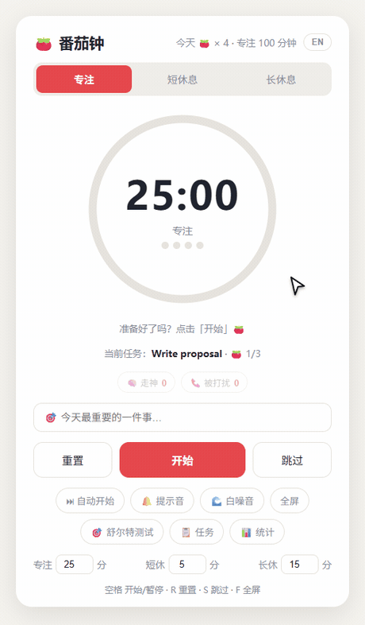
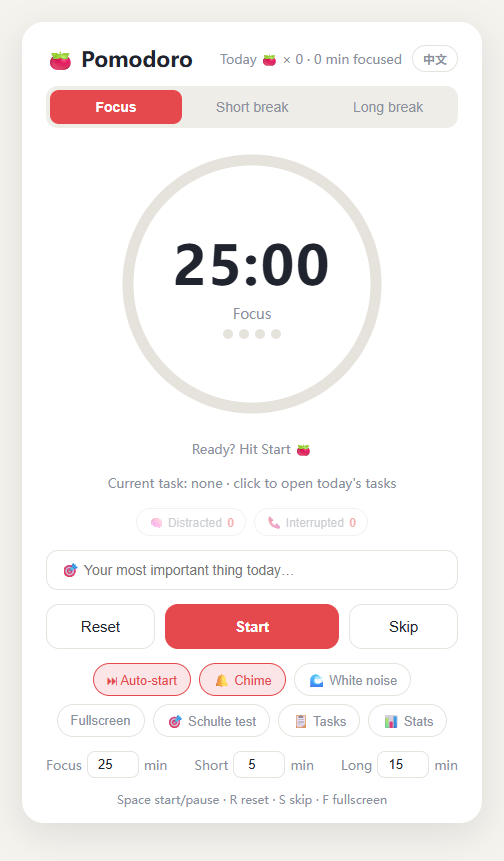
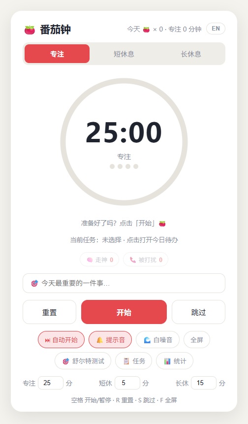

# 🍅 Pomodoro Tray · 番茄钟

[English](#english) · [简体中文](#简体中文)

[](./LICENSE)
[](https://chen0521yuxuan.github.io/pomodoro-tray/)
[](https://github.com/chen0521yuxuan/pomodoro-tray/releases)
[](#)
[](#)
[](https://github.com/chen0521yuxuan/pomodoro-tray/stargazers)

<p align="center">
  
</p>

<p align="center"><sub>11-second demo · 11 秒演示：中文 / English · tasks · interruptions · stats</sub></p>

<details>
<summary>More screenshots · 更多截图</summary>
<p align="center">
  
  
</p>
</details>

---

## English

A bilingual, offline-first Pomodoro app for Windows and the web. It combines a classic focus timer with today's task estimates, interruption tracking, focus statistics, a Schulte grid, white noise, and an always-on system tray — all in a single HTML file plus a thin Electron shell.

Switch the entire UI — including the tray menu and notifications — between **中文 and English** with one click. No account, no network, no telemetry: everything stays in `localStorage` on your machine.

### Features

- 🍅 **Pomodoro cycle** — focus / short break / long break, custom durations, auto-start, long break after every 4 pomodoros.
- 🌐 **Bilingual by design** — one-click 中文/EN switch; the choice is saved and applies to the window, tray menu, tooltips and system notifications.
- 📋 **Today's tasks** — estimate 1–7 pomodoros per task, pick the current task, and let completed focus sessions count toward it automatically. The list refreshes automatically at **midnight in your system time zone**, even while the app is idle; unfinished tasks carry over and completed ones are archived. A **Clear list** button lets you force a fresh start at any time. Tasks marked done mid-session still receive the in-progress pomodoro.
- 🧠 **Interruption tracking** — log internal distractions and external interruptions without pausing the timer; daily and 7-day counts appear in stats.
- 📊 **Focus stats** — daily minutes/pomodoros, 7-day chart, active-day streak, totals, and interruption counts; export/import a JSON backup (tasks included).
- 🎯 **Schulte grid** — 4×4 / 5×5 / 6×6 attention exercise with mistake counting and per-size best times.
- 🌊 **White noise** — synthesized pink noise, no audio files needed.
- 🔔 **Chime & notifications** — Web Audio bell plus native notifications while the window is hidden.
- 🖥 **Tray-first** — closing the window keeps the timer running; the tray tooltip shows the remaining time and the context menu controls the session.
- 🌙 **Dark mode**, fullscreen mode, and a daily goal line.
- 🔒 **Local-only data** — no sign-in, no cloud, no tracking.

### Quick start

**Web version (zero install)**

Try the [live demo](https://chen0521yuxuan.github.io/pomodoro-tray/), or open `番茄钟.html` from the repo in any modern browser. Everything except the native tray works.

**Desktop tray version (Electron, Windows tested)**

```bash
git clone https://github.com/chen0521yuxuan/pomodoro-tray.git
cd pomodoro-tray
npm install
npm start
```

> If Electron downloads slowly in China, use a mirror before `npm install`:
> ```bash
> npm config set registry https://registry.npmmirror.com
> # PowerShell:
> $env:ELECTRON_MIRROR = 'https://npmmirror.com/mirrors/electron/'
> ```

**Portable share build**

1. After `npm install`, zip the whole folder (including `node_modules`).
2. Add a `Start Pomodoro.bat` containing:
   ```bat
   start "" "%~dp0node_modules\electron\dist\electron.exe" "%~dp0"
   ```
3. Optional: replace the Electron icon with the tomato icon:
   ```bash
   node gen-icon.js
   node scripts/patch-icon.js node_modules/electron/dist/electron.exe tomato.ico
   ```

### How to use

1. Press **EN / 中文** in the top-right to choose your language.
2. Set focus / short break / long break durations at the bottom.
3. Open **📋 Tasks**, add what you want to finish, estimate 1–7 pomodoros, and select the current task.
4. Press **Start**. If your mind wanders or someone interrupts you, tap **🧠 Distracted** or **📞 Interrupted** — the timer keeps running.
5. Take the short break when the bell rings; after 4 pomodoros you get a long break.
6. Open **📊 Stats** to review time, pomodoros, interruptions and streaks. **📤 Export backup** saves a JSON copy.

### Keyboard shortcuts

| Key | Action |
| --- | --- |
| `Space` | Start / pause |
| `R` | Reset the current round |
| `S` | Skip to the next phase |
| `F` | Toggle fullscreen |
| `Esc` | Close the open panel |

### Project structure

| File | Purpose |
| --- | --- |
| `番茄钟.html` | The entire web app: UI, styles, timer, tasks, stats, Schulte grid, i18n |
| `index.html` | GitHub Pages entry that opens the app |
| `main.js` | Electron main process: window, tray, notifications, IPC bridge |
| `preload.js` | Safe `contextBridge` between the page and Electron |
| `gen-icon.js` | Tomato icon generator (PNG/ICO, no dependencies) |
| `scripts/patch-icon.js` | Writes the tomato icon into `electron.exe` resources |
| `screenshots/` | Bilingual UI screenshots used in this README |

### Tech stack

- Vanilla HTML + CSS + JavaScript — no framework, no build step
- Electron for the tray app
- Web Audio API for the bell and pink noise
- `localStorage` for settings, history and tasks

### Contributing

Issues and pull requests are welcome. If this project saves you some focus time, a ⭐ helps more people find it — thank you!

### License

[MIT](./LICENSE)

---

## 简体中文

一个中英双语、完全离线的番茄工作法应用，支持 Windows 桌面托盘版和纯网页版。它把经典专注计时、今日任务预估、中断记录、专注统计、舒尔特方格、白噪音和常驻托盘合在一起：全部界面与逻辑都在一个 HTML 文件里，Electron 只负责桌面外壳。

点击右上角的 **EN / 中文** 即可切换整个界面，托盘菜单、提示和系统通知也会跟着换语言。无需账号、不联网、不上传数据，所有设置和统计都保存在本机 `localStorage`。

### 功能特性

- 🍅 **完整番茄循环**：专注 / 短休息 / 长休息，时长可自定义并自动保存；每 4 个番茄进入长休息，可自动开始下一阶段。
- 🌐 **真正的中英双语**：一键切换；语言会记住，窗口、托盘菜单、托盘提示和系统通知同步切换。
- 📋 **今日待办**：给每项任务预估 1~7 个番茄，选择当前任务，完成的专注自动记到任务上；**按系统本地时区在 0 点自动刷新（应用空闲时也生效）**，已完成归档、未完成顺延；任务面板提供**「清空任务」**按钮，可随时强制清零重新开始。中途勾完成也会收到本轮番茄。
- 🧠 **中断记录**：专注中一键记录「走神」和「被打扰」，番茄不暂停；今日和近 7 天的中断次数进入统计。
- 📊 **专注统计**：每日分钟数/番茄数、近 7 天柱状图、连续天数、累计数据与中断次数；支持 JSON 备份导出/导入（含今日待办）。
- 🎯 **舒尔特方格**：4×4 / 5×5 / 6×6 专注力训练，点错计数，自动记录每种规格的最佳成绩。
- 🌊 **白噪音**：实时合成粉红噪声，不需要任何音频文件。
- 🔔 **完成提醒**：合成钟声 + 系统通知，窗口隐藏时也会准时提醒。
- 🖥 **托盘常驻**：点 × 只隐藏窗口，倒计时继续；托盘悬停显示剩余时间，右键菜单可开始/暂停/跳过/退出。
- 🌙 **深色模式**、全屏沉浸、今日目标输入。
- 🔒 **数据只在本机**：无登录、无云端、无追踪。

### 快速开始

**网页版（零依赖）**

试试[在线演示](https://chen0521yuxuan.github.io/pomodoro-tray/)，或下载后用浏览器打开 `番茄钟.html`。除系统托盘外功能完整。

**桌面托盘版（Electron，Windows 已测试）**

```bash
git clone https://github.com/chen0521yuxuan/pomodoro-tray.git
cd pomodoro-tray
npm install
npm start
```

> 国内网络可先设置镜像再安装：
> ```bash
> npm config set registry https://registry.npmmirror.com
> # PowerShell:
> $env:ELECTRON_MIRROR = 'https://npmmirror.com/mirrors/electron/'
> ```

**绿色版分享**

1. `npm install` 完成后，把整个项目文件夹（含 `node_modules`）压缩为 zip。
2. 新建 `启动番茄钟.bat`，内容为：
   ```bat
   start "" "%~dp0node_modules\electron\dist\electron.exe" "%~dp0"
   ```
3. 可选：把任务栏/托盘图标换成番茄：
   ```bash
   node gen-icon.js
   node scripts/patch-icon.js node_modules/electron/dist/electron.exe tomato.ico
   ```

### 使用方法

1. 点右上角的 **EN / 中文** 选择语言。
2. 在底部设置专注、短休、长休时长。
3. 打开 **📋 任务**，写下今天要做的事，预估 1~7 个番茄，并选中当前任务。
4. 点 **开始**。走神或被打扰时，点 **🧠 走神** 或 **📞 被打扰** 记录一下，计时不会中断。
5. 铃响后休息；完成 4 个番茄后进入长休息。
6. 打开 **📊 统计** 查看时长、番茄数、中断次数和连续天数；**📤 导出备份** 可保存 JSON 副本。

### 快捷键

| 按键 | 作用 |
| --- | --- |
| `空格` | 开始 / 暂停 |
| `R` | 重置本轮 |
| `S` | 跳过当前阶段 |
| `F` | 全屏 |
| `Esc` | 关闭弹层 |

### 项目结构

| 文件 | 说明 |
| --- | --- |
| `番茄钟.html` | 完整网页应用：界面、样式、计时、任务、统计、舒尔特方格、中英双语 |
| `index.html` | GitHub Pages 入口页，跳转到应用 |
| `main.js` | Electron 主进程：窗口、托盘、通知、IPC 桥接 |
| `preload.js` | 页面与 Electron 之间的安全 `contextBridge` |
| `gen-icon.js` | 番茄图标生成器（PNG/ICO，零依赖） |
| `scripts/patch-icon.js` | 把番茄图标写入 `electron.exe` 资源 |
| `screenshots/` | README 使用的中英双语界面截图 |

### 技术栈

- 原生 HTML + CSS + JavaScript，无框架、无构建步骤
- Electron 桌面托盘
- Web Audio API 实时合成铃声与粉红噪声
- `localStorage` 保存设置、统计和任务

### 参与贡献

欢迎提交 Issue 和 Pull Request。如果这个项目帮你省下了一些专注时间，点一个 ⭐ 能让更多人发现它，非常感谢！

### 许可证

[MIT](./LICENSE)
